# 大观园 · Grand View Garden（3D 体素复原）

> 依《红楼梦》原文与红学考据复原的**大观园三维体素园林**。纯前端、零依赖后端、单文件可离线打开，PC 与移动端浏览器均可漫游。

**在线访问（GitHub Pages）**：在仓库 Settings → Pages 中选择 `main` 分支根目录（或 GitHub Actions）启用后，即可访问 `https://wentao1176.github.io/GrandViewGarden/`
**本地打开**：直接双击仓库根目录的 `index.html`（无需服务器、无需联网），或用 `npm run dev` 起本地服务。

---

## 一、它是什么

一座可以走进去的「大观园」：以 1 体素 ≈ 1 米的比例，用约 **60 万方块面 / 120 万顶点** 重建了：

- **中轴**：五间正门（筒瓦泥鳅脊、水磨砖墙、虎皮石下碱）→ 翠嶂·曲径通幽（穿山石洞）→ 三孔沁芳桥与桥上沁芳亭 → 省亲别墅玉石牌坊 → 顾恩思义殿 → 二层大观楼与东西飞楼（含芳阁、缀锦阁，复道相连）
- **四主院**：潇湘馆（千百竿翠竹、引泉绕阶）、怡红院（西府海棠与芭蕉、月洞门、抄手游廊）、蘅芜苑（大玲珑山石、无花木、香草藤蔓、五间卷棚）、稻香村（黄泥墙、杏林、菜畦、茅屋、桔槔土井）
- **水系洲渚**：沁芳溪一条连通（沁芳闸→东北山坳→花溆萝港→沁芳池→沁芳亭→东南出水口），藕香榭、紫菱洲·缀锦楼、荇叶渚、滴翠亭、蜂腰桥、九曲桥、棠木舫
- **山寺与园景**：栊翠庵（红梅、苦海慈航）、凸碧山庄·凹晶溪馆（一山一水对景）、秋爽斋·晓翠堂、蓼风轩·暖香坞、芦雪庵、红香圃·芍药栏、柳叶渚、牡丹亭、蔷薇院、芭蕉坞、沁芳闸等
- **匾额楹联**：曲径通幽、沁芳（绕堤柳借三篙翠 / 隔岸花分一脉香）、有凤来仪→潇湘馆、红香绿玉→怡红快绿、蘅芷清芬、杏帘在望→浣葛山庄→稻香村、顾恩思义、省亲别墅、苦海慈航、藕香榭联、晓翠堂联等（均以 CanvasTexture 悬于建筑原位）
- **昼夜四时**：晨、昼、暮、夜四种光照与天空/水面调色，夜间灯笼与窗纸自发光，花瓣飘落、飞鸟、云影

界面提供：景点目录、带原文引文与考据说明的信息卡、可点击小地图、自动漫游（含原文一句字幕）、地名标签、赏景模式与帮助弹层。

## 效果预览

| 全园总览（昼） | 大观园正门 |
|---|---|
| 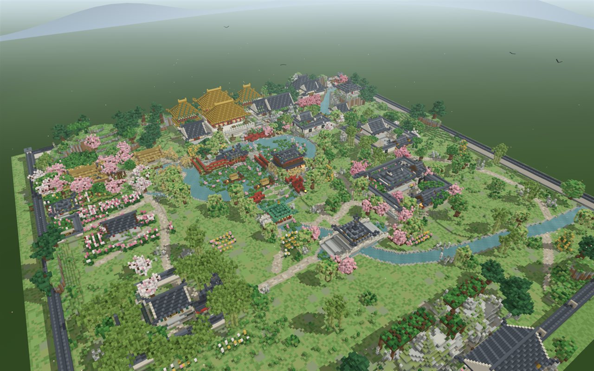 | 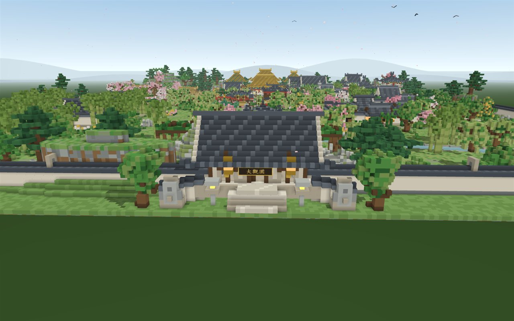 |
| **沁芳亭·沁芳桥** | **省亲别墅·大观楼** |
| 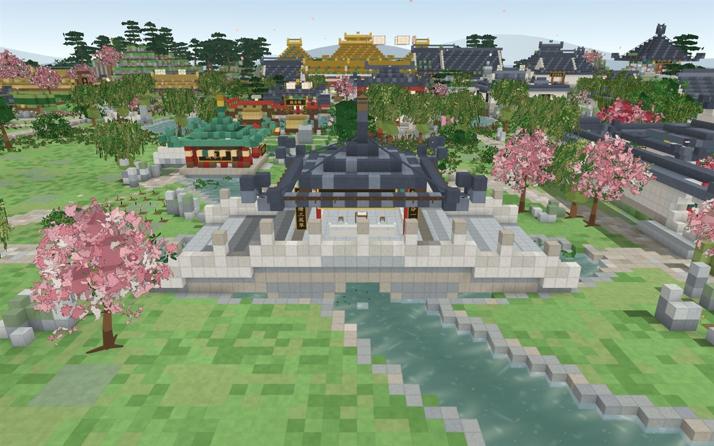 | 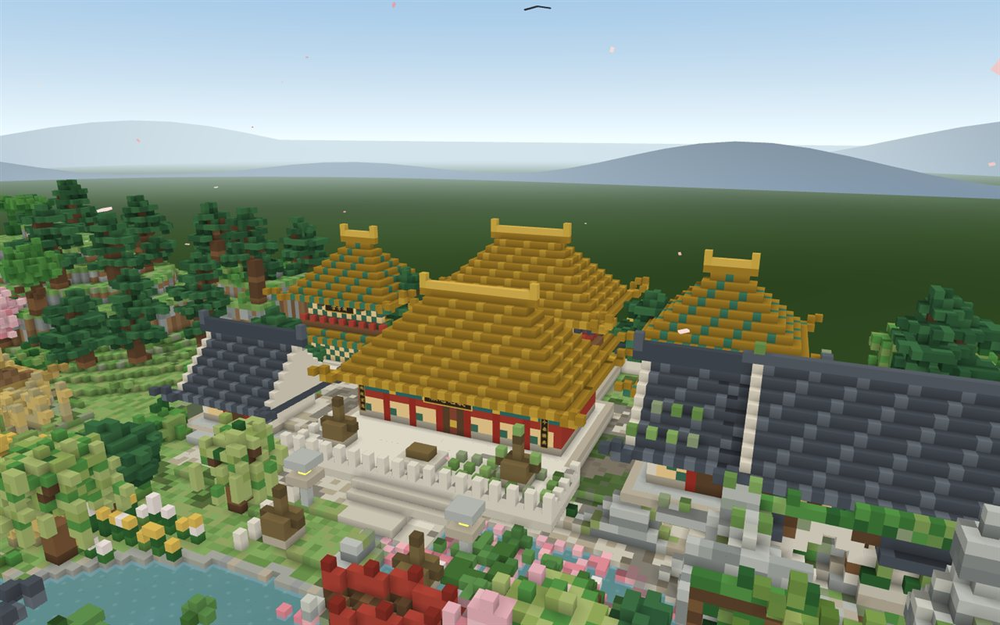 |
| **怡红院** | **潇湘馆** |
| 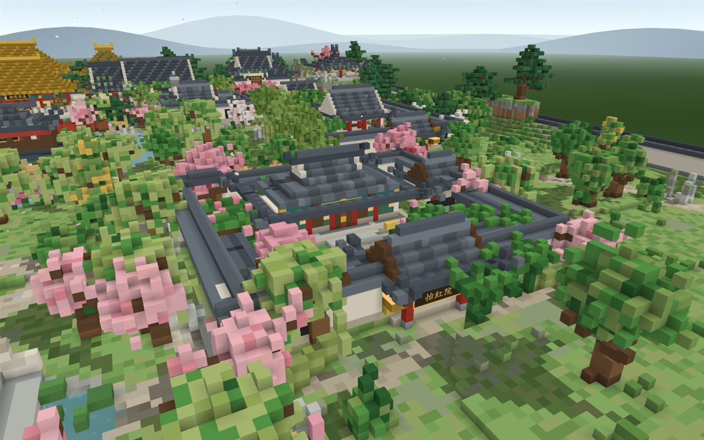 | 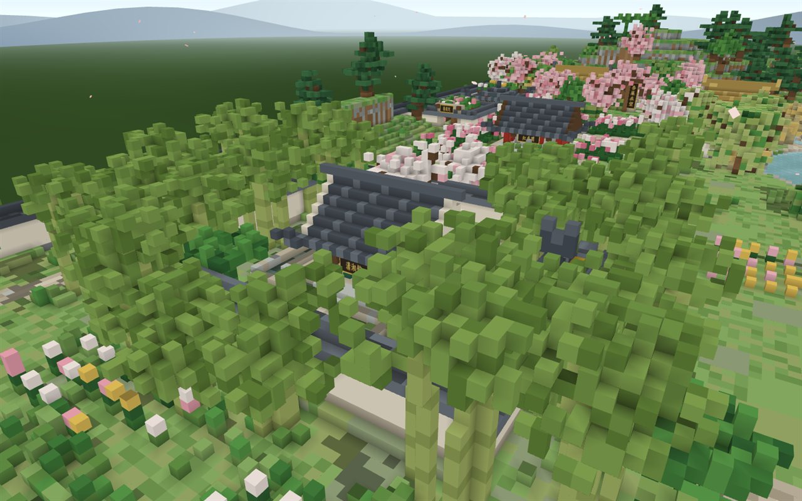 |
| **稻香村** | **蘅芜苑** |
| 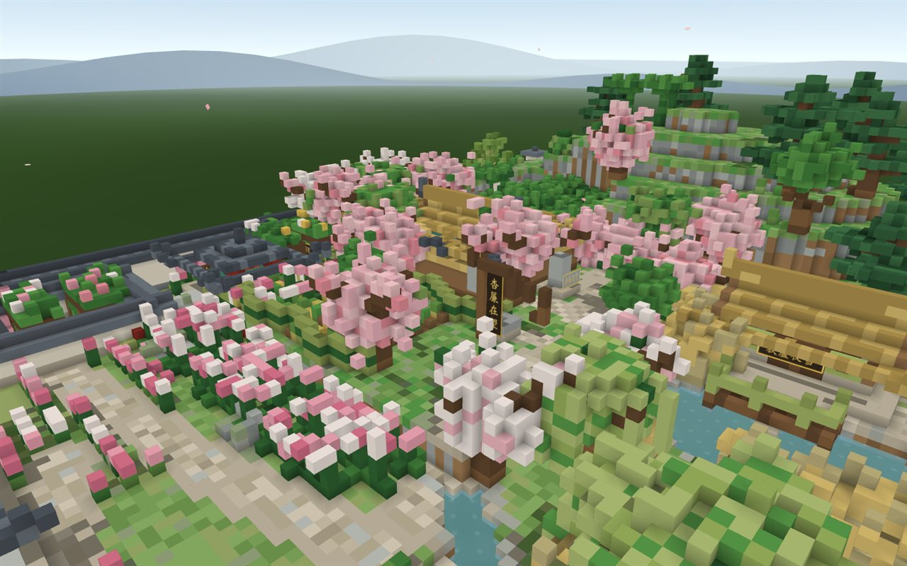 | 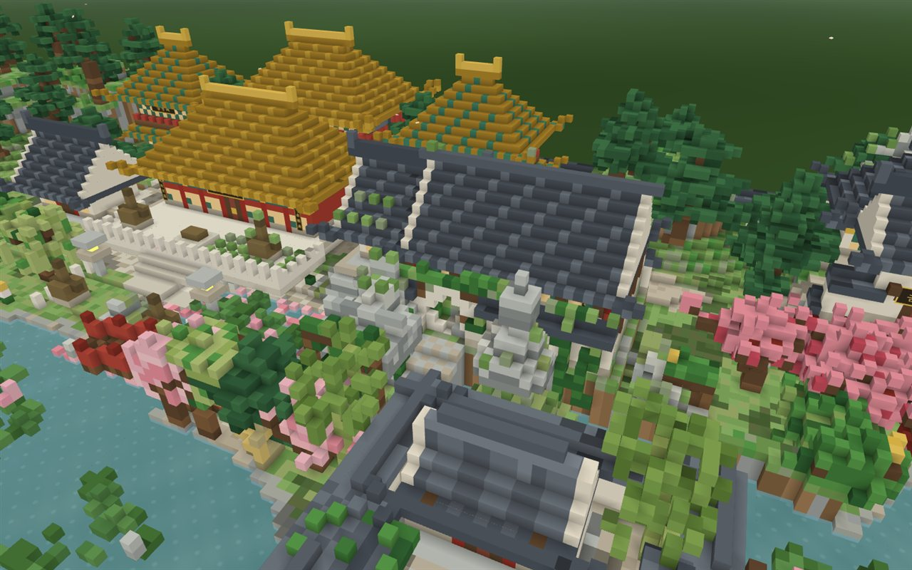 |
| **栊翠庵** | **藕香榭** |
| 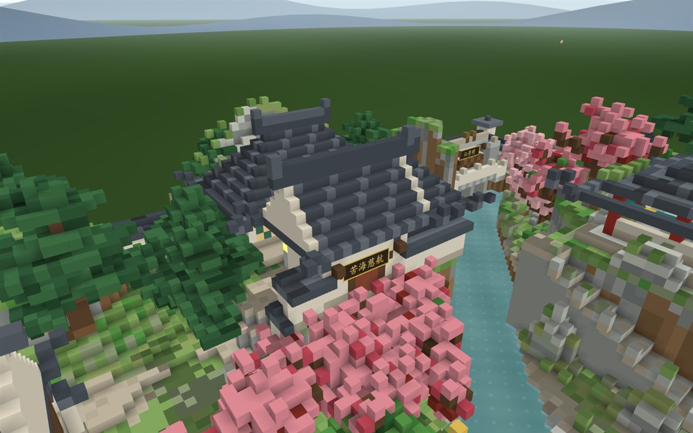 | 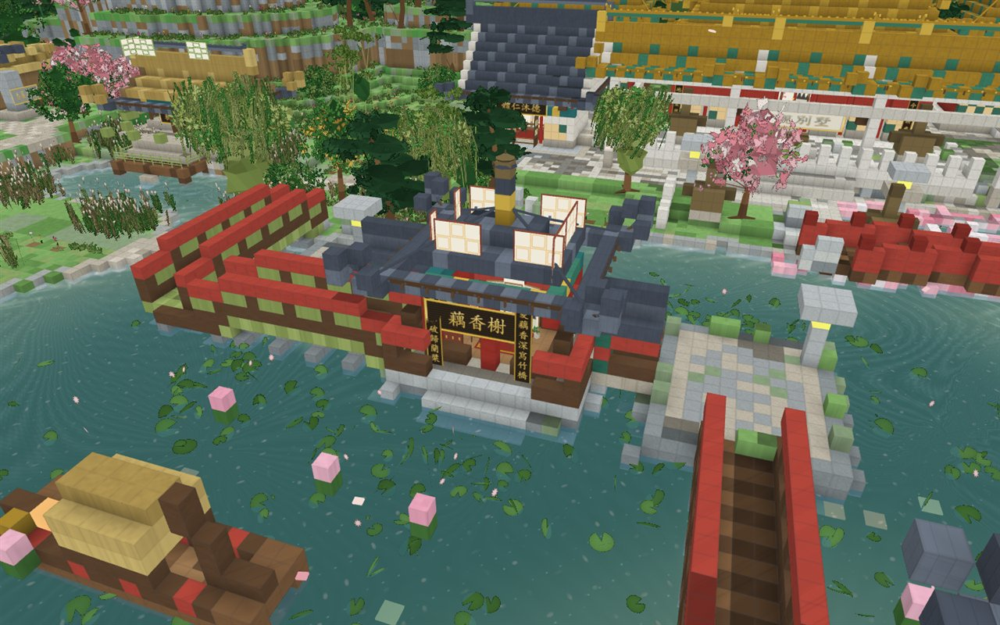 |
| **紫菱洲·缀锦楼** | **夜游大观园** |
| 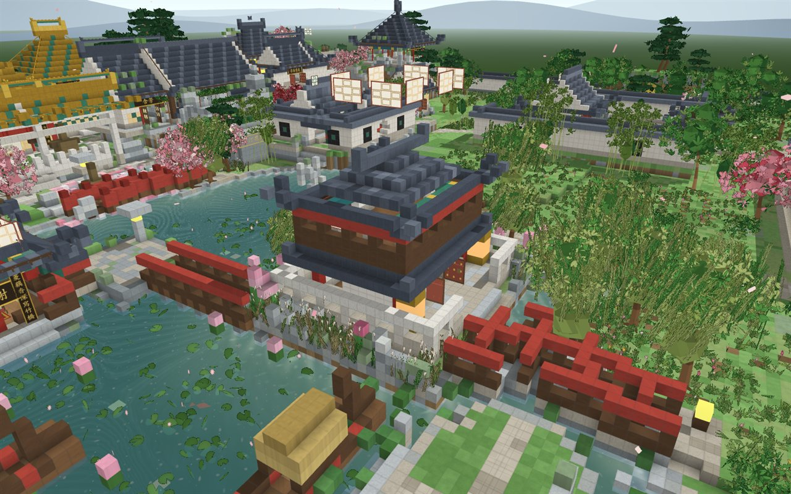 | 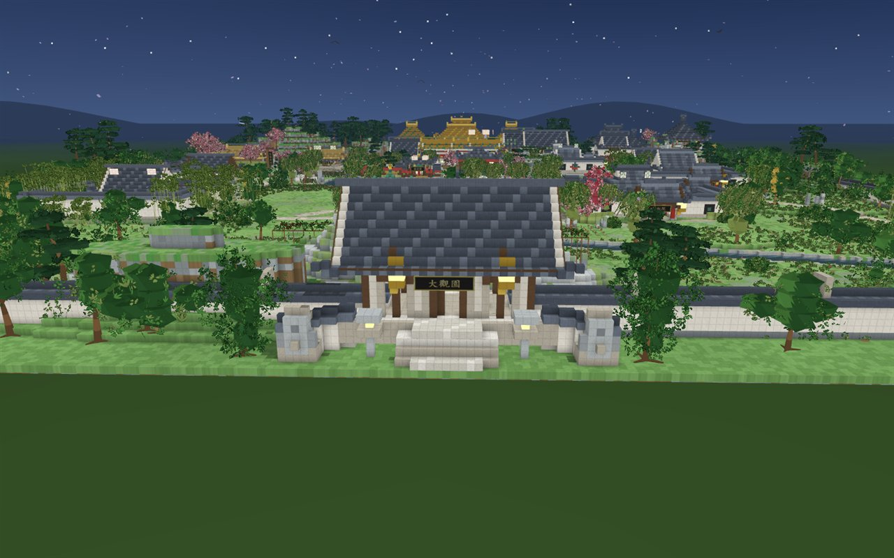 |
| **黄昏** | **移动端界面** |
| 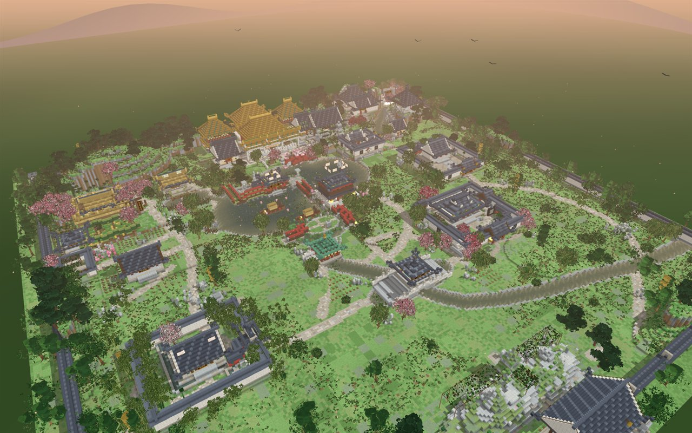 | 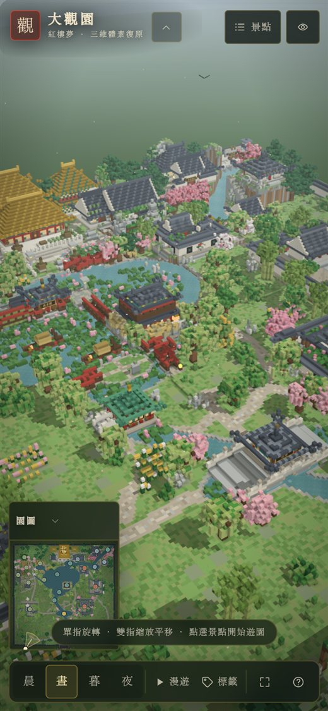 |


## 二、技术实现

- **纯前端**：`three.js r169` + 自研体素引擎，esbuild 打包并**内联为单个 `index.html`**（离线可用，无外部请求）。
- **体素世界**：320 × 96 × 320 稠密网格（约 983 万格），16³ 分块标记非空区域。
- **贪心网格化**：每面按「颜色 + 4 角 AO + 方向 + 阴影」合并为矩形，显著减少面数与 draw call；输出「受光体素」与「自发光体素」两套几何。
- **烘焙光照**：面朝向明暗 + 顶点环境光遮蔽（AO）+ 依据太阳方位的高度场阴影（建筑/山体投影到地面）。无实时阴影贴图，移动端也稳定。
- **自定义着色器**：天空穹顶（日/月、地平线霞光）、水面（菲涅耳、波纹、日光高光、雾混合）、水面为独立透明网格，与体素解耦。
- **UI**：原生 DOM + Canvas 小地图 + 内联 SVG 图标，无框架；响应式（桌面/移动/横屏）、安全区、键盘快捷键、无障碍标签。
- **性能自适应**：移动端自动降像素比/画质，运行中动态分辨率调节；面数、draw call 与体素统计可在性能面板查看。

## 三、目录结构

```
index.html              最终交付：单文件（内联 CSS/JS），双击即开
src/
  main.js               入口：加载、建园编排、相机/事件/app API、地名标签
  core/                 体素引擎：palette / world / mesher / renderer / controls / decals
  garden/
    layout.js           总平面唯一依据：山体/水体/道路/院墙/分区/景点/桥位
    terrain.js          地形、水系掩膜、道路、园墙、园外环境
    helpers.js          建筑生成器：台基/屋顶（歇山·庑殿·硬山·卷棚·攒尖）/厅堂/亭/
                        游廊/桥/牌坊/月洞门/花窗/栏杆/假山/匾额
    flora.js            植物与山石：松/柳/杏/桃/梅/竹/芭蕉/梧桐/荷/苇/芍药/藤萝/湖石
    scenes/
      axis.js           中轴：正门/翠嶂/沁芳亭桥/牌坊/正殿/大观楼/配楼
      east.js           怡红院/秋爽斋/暖香坞/滴翠亭
      west.js           潇湘馆/稻香村/芦雪庵/红香圃/柳叶渚/园西小景
      north.js          蘅芜苑/栊翠庵/凸碧山庄/凹晶溪馆/花溆/沁芳闸
      water.js          藕香榭/紫菱洲·缀锦楼/荇叶渚/诸桥/棠木舫
    index.js            建园编排、水面植被兜底、小地图位图
  data/poi-content.js   景点文案：原文引文、匾联、考据简介
  ui/                   界面模块（启动页/目录/信息卡/小地图/漫游/帮助/性能面板）
  styles.css            全部样式
docs/
  research.md           大观园空间考据（40×40 总平面、尺寸、逐景点原文、植物/匾联清单）
  implementation-notes.md 建模实现说明与取舍（尺度、桥梁微调、形制、已知差距）
  engine-api.md         引擎与协作契约（坐标、API、规则）
  screenshots/          效果截图（README 用）
tools/                  预览/全量审查截图工具（puppeteer-core + 本机 Chrome）
scripts/                构建（单文件内联）与开发服务器
```

## 四、开发与构建

```bash
npm install                     # 安装 three / esbuild / puppeteer-core（仅开发用）
npm run build                   # 生成 index.html（单文件，内联全部 JS/CSS）
npm run dev                     # 构建并起本地服务 http://127.0.0.1:8080
node tools/preview.mjs --name=me --views="overview;poi:yihong" --clean
node tools/qa.mjs               # 全量截图审查（24 景点 + 晨/暮/夜 + 移动端），输出 ref/qa/
```

构建后的 `index.html` 即为最终交付：可直接分发、离线打开，也可直接部署到任意静态托管（GitHub Pages 等）。

## 五、操作方式

- **PC**：左键拖拽旋转，右键/中键拖拽平移，滚轮缩放；点击景点目录或小地图飞行前往。
- **移动端**：单指拖拽旋转，双指捏合缩放/平移；左下小地图可点击。
- **快捷键**：`1/2/3/4` 晨/昼/暮/夜，`T` 漫游，`L` 地名标签，`H` 赏景模式，`Esc` 关闭弹层/信息卡，`?` 帮助。
- 右侧/底部按钮：景点目录、时段、漫游、标签、全屏、说明。

## 六、考据说明

- 空间与文本依据见 [`docs/research.md`](docs/research.md)：以《红楼梦》第 16/17/18/23/27/38/40/41/62 回原文为主（A 级），辅以红学通行复原（B 级）与建模取舍（C 级）。
- 中轴不可弯、四院方位、沁芳溪单线连通、三处地形关系（大主山分支穿蘅芜苑、花溆云步石梯、翠嶂障景）、匾联改题关系等硬约束均在模型中体现。
- 「三里半大」折算取约 13.6 公顷量级；园内平面以 1 体素 ≈ 1 米抽象重建，建筑尺度按清式民居/官式建筑参数适度归纳，**非测绘复原**，属文学园林的数字艺术诠释。
- 引文以识典古籍整理本逐字核对；部分回目为节引，已在文档中标注。

## 七、致谢与许可

- 文本：《红楼梦》（曹雪芹著，公有领域）。
- 灵感与考据参考：周汝昌、冯其庸、杨乃济等红学前辈的大观园研究，以及北京大观园（1984–1988）的复原实践。
- 代码以 MIT 许可发布；文中引文属公有领域。欢迎 fork、补充考据与继续完善。

---

> 满纸荒唐言，一把辛酸泪。都云作者痴，谁解其中味？
> —— 愿这座小园，能让书中人在你的屏幕上再游一次。
