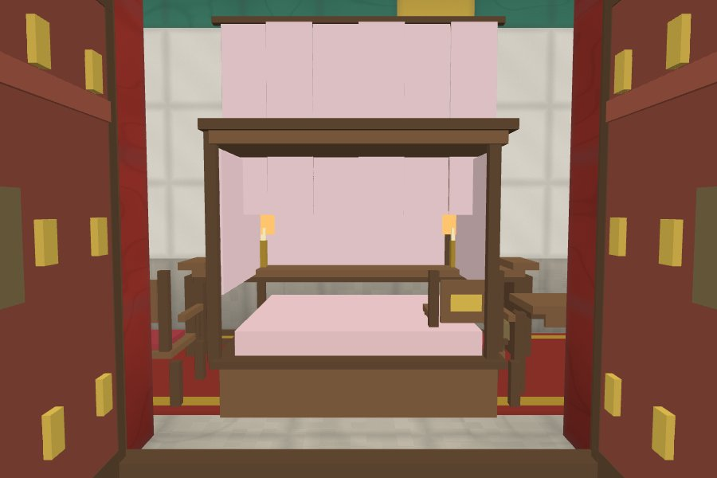
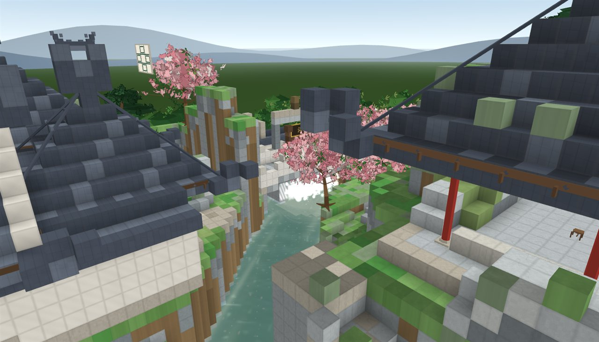
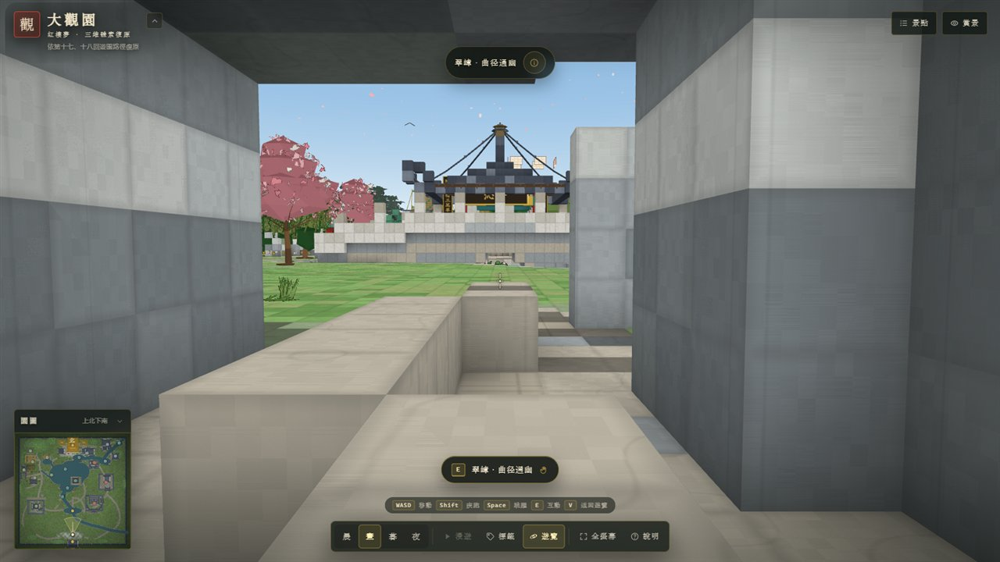

# 大观园 · Grand View Garden（3D 体素复原）

> 依《红楼梦》原文与红学考据复原的**大观园三维体素园林**。纯前端、零依赖后端、单文件可离线打开，PC 与移动端浏览器均可漫游。

**在线访问（GitHub Pages）**：在仓库 Settings → Pages 中选择 `main` 分支根目录（或 GitHub Actions）启用后，即可访问 `https://wentao1176.github.io/GrandViewGarden/`
**本地打开**：直接双击仓库根目录的 `index.html`（无需服务器、无需联网），或用 `npm run dev` 起本地服务。

---

## 一、它是什么

一座可以走进去的「大观园」：以 1 体素 ≈ 1 米为骨架、程序化材质与精细构件为皮，用约 **13.8 万体素方块面（≈110 万三角面）** 重建了：

- **中轴**：五间正门（筒瓦泥鳅脊、水磨砖墙、虎皮石下碱）→ 翠嶂·曲径通幽（穿山石洞）→ 三孔沁芳桥与桥上沁芳亭 → 省亲别墅玉石牌坊 → 顾恩思义殿 → 二层大观楼与东西飞楼（含芳阁、缀锦阁，复道相连）
- **四主院**：潇湘馆（千百竿翠竹、引泉绕阶）、怡红院（西府海棠与芭蕉、月洞门、抄手游廊）、蘅芜苑（大玲珑山石、无花木、香草藤蔓、五间卷棚）、稻香村（黄泥墙、杏林、菜畦、茅屋、桔槔土井）
- **水系洲渚**：沁芳溪一条连通（沁芳闸→东北山坳→花溆萝港→沁芳池→沁芳亭→东南出水口），藕香榭、紫菱洲·缀锦楼、荇叶渚、滴翠亭、蜂腰桥、九曲桥、棠木舫
- **山寺与园景**：栊翠庵（红梅、苦海慈航）、凸碧山庄·凹晶溪馆（一山一水对景）、秋爽斋·晓翠堂、蓼风轩·暖香坞、芦雪庵、红香圃·芍药栏、柳叶渚、牡丹亭、蔷薇院、芭蕉坞、沁芳闸等
- **匾额楹联**：曲径通幽、沁芳（绕堤柳借三篙翠 / 隔岸花分一脉香）、有凤来仪→潇湘馆、红香绿玉→怡红快绿、蘅芷清芬、杏帘在望→浣葛山庄→稻香村、顾恩思义、省亲别墅、苦海慈航、藕香榭联、晓翠堂联等（均以 CanvasTexture 悬于建筑原位）
- **昼夜四时**：晨、昼、暮、夜四种光照与天空/水面调色，夜间灯笼与窗纸自发光，花瓣飘落、飞鸟、云影
- **HD 精细升级（第二版）**：
  - **材质细节**：程序化着色器为每类体素生成瓦垄/瓦排、粉墙水渍、石缝、木纹、石板缝、草地色斑，并对每个体素做弱倒角——不再是平涂大方块；
  - **精细构件**：封檐板、瓦当、飞檐角梁、正脊鸱吻、垂脊走兽、圆柱斗拱、四式门窗棂、木/石/竹栏杆、可开合板门/隔扇门，以及 18 类室内家具陈设（条案/太师椅/架子床/书架/三扇屏风/字画/香炉烛台/地毯/帷幔…），共 ≈9.5 万三角面、4–5 draw call；
  - **会动的植被**：约 11.8 万叶片 + 5.5 万草花实例，风摆 shader（柳条大摆、竹叶簌簌、荷荇轻浮）；松/柳/竹/蕉/海棠/杏/桃/梅/梧桐/银杏各具形色；
  - **活的流水**：沿溪流向场、五层波纹、岸边/桥墩/闸口泡沫、沁芳闸与花溆跌水白浪水花、四时水色反射、14 条锦鲤；
  - **可以走进去**：第一人称步行（碰撞/台阶/开门/水域限制），24 个景点传送落点，厅堂/卧室/佛堂/水榭均可入内观赏；建筑整体增高 1.2–1.5×；
  - 桌面约 150 draw call / 112 万三角面，移动端自动降至约 96 draw call / 73 万三角面。

界面提供：景点目录、带原文引文与考据说明的信息卡、可点击小地图、自动漫游（含原文一句字幕）、地名标签、赏景模式与帮助弹层；步行模式下增加准星、虚拟摇杆、疾跑/跳跃/退出与交互提示。

## 效果预览

| 全园总览（昼） | 大观园正门 |
|---|---|
|  |  |
| **沁芳亭·沁芳桥** | **省亲别墅·大观楼** |
|  |  |
| **怡红院** | **潇湘馆** |
|  |  |
| **稻香村** | **蘅芜苑** |
|  |  |
| **栊翠庵** | **藕香榭** |
|  |  |
| **紫菱洲·缀锦楼** | **夜游大观园** |
|  |  |
| **黄昏** | **移动端界面** |
|  |  |
| **正殿室内（可入内）** | **暖香坞卧室** |
|  |  |
| **沁芳闸跌水** | **步行模式** |
|  |  |


## 二、技术实现

- **纯前端**：`three.js r169` + 自研体素引擎，esbuild 打包并**内联为单个 `index.html`**（离线可用，无外部请求）。
- **体素世界**：320 × 96 × 320 稠密网格（约 983 万格），16³ 分块标记非空区域。
- **贪心网格化**：每面按「颜色 + 4 角 AO + 方向 + 阴影」合并为矩形，显著减少面数与 draw call；输出「受光体素」与「自发光体素」两套几何。
- **烘焙光照**：面朝向明暗 + 顶点环境光遮蔽（AO）+ 依据太阳方位的高度场阴影（建筑/山体投影到地面）。无实时阴影贴图，移动端也稳定。
- **自定义着色器**：天空穹顶（日/月、地平线霞光）、动态水面（流向场、五层波、岸边/桥墩/跌水泡沫、菲涅耳反射、水花粒子）、体素材质细节（瓦垄/粉墙/石缝/木纹/草地+倒角）。
- **精细构件网格**：helpers 输出构件规格 → ornaments 合并为少量 Mesh；门窗棂/栏杆/门/家具均为 0.05–0.3m 精细尺度，体素只保留碰撞与大体量。
- **实例化植被**：叶片卡 InstancedMesh + 风摆 shader + 程序化图集；8 个植被 draw call 承载 17 万实例。
- **第一人称步行**：自研 Walker（AABB 碰撞/台阶/重力/门开合/水域限制/室内提亮），与轨道相机一键切换；移动端虚拟摇杆。
- **UI**：原生 DOM + Canvas 小地图 + 内联 SVG 图标，无框架；响应式（桌面/移动/横屏）、安全区、键盘快捷键、无障碍标签。
- **性能自适应**：移动端自动降像素比/画质，运行中动态分辨率调节；面数、draw call 与体素统计可在性能面板查看。

## 三、目录结构

```
index.html              最终交付：单文件（内联 CSS/JS），双击即开
src/
  main.js               入口：加载、建园编排、相机/事件/app API、地名标签、步行/水系/精细构件接线
  core/                 体素引擎：palette / world / mesher / renderer / controls / decals
                        + water（动态水系）/ walker（第一人称步行）/ doors（门扇）
  garden/
    layout.js           总平面唯一依据：山体/水体/道路/院墙/分区/景点/桥位/步行落点
    terrain.js          地形、水系掩膜、道路、园墙、园外环境
    helpers.js          建筑生成器：台基/屋顶/厅堂/亭/游廊/桥/牌坊/月洞门/花窗/栏杆/假山/匾额
                        + 精细构件规格（roofs/columns/lattices/railings/doors/furniture）与 H.furnish
    ornaments.js        精细构件/门窗/栏杆/家具/灯具网格生成（合并 Mesh）
    flora.js            植被生成：松/柳/杏/桃/梅/竹/芭蕉/梧桐/荷/苇/芍药/藤萝/湖石
    foliage.js          叶片实例批次、风摆 shader、程序化图集、低模枝干/冠核
    scenes/
      axis.js           中轴：正门/翠嶂/沁芳亭桥/牌坊/正殿/大观楼/配楼
      east.js           怡红院/秋爽斋/暖香坞/滴翠亭
      west.js           潇湘馆/稻香村/芦雪庵/红香圃/柳叶渚/园西小景
      north.js          蘅芜苑/栊翠庵/凸碧山庄/凹晶溪馆/花溆/沁芳闸
      water.js          藕香榭/紫菱洲·缀锦楼/荇叶渚/诸桥/棠木舫
    index.js            建园编排、水面植被兜底、postBuild/animator 管线、小地图位图
  data/poi-content.js   景点文案：原文引文、匾联、考据简介
  ui/                   界面模块（启动页/目录/信息卡/小地图/漫游/帮助/步行 HUD/性能面板）
  styles.css            全部样式
docs/
  research.md           大观园空间考据（40×40 总平面、尺寸、逐景点原文、植物/匾联清单）
  implementation-notes.md 建模实现说明与取舍（尺度、桥梁微调、形制、HD 升级、已知差距）
  engine-api.md         引擎与协作契约（坐标、API、规则）
  phase2-api.md         HD 升级协作契约（材质/构件/植被/水系/步行/性能预算）
  screenshots/          效果截图（README 用）
tools/                  预览/全量审查截图工具（puppeteer-core + 本机 Chrome）
scripts/                构建（单文件内联）与开发服务器
```

## 四、开发与构建

```bash
npm install                     # 安装 three / esbuild / puppeteer-core（仅开发用）
npm run build                   # 生成 index.html（单文件，内联全部 JS/CSS）
npm run dev                     # 构建并起本地服务 http://127.0.0.1:8080
node tools/preview.mjs --name=me --views="overview;poi:yihong" --clean
node tools/qa.mjs               # 全量截图审查（24 景点 + 晨/暮/夜 + 移动端），输出 ref/qa/
node tools/final-check.mjs      # 交付前校验：file:// 直开、桌面/移动端、0 console error、0 外部请求
node tools/walk-check.mjs --x=59 --z=40 --heading=0 --seconds=6   # 步行可达性 E2E（入室）
```

构建后的 `index.html` 即为最终交付：可直接分发、离线打开，也可直接部署到任意静态托管（GitHub Pages 等）。

## 五、部署到 GitHub Pages

仓库已为 Pages 静态托管做好准备：根目录 `index.html` 是构建产物（单文件、全部资源内联），并已放置 `.nojekyll`（跳过 Jekyll 处理，避免下划线开头资源被忽略）。

**方式 A：分支部署（推荐，无需 CI）**

1. 打开仓库 **Settings → Pages**；
2. **Build and deployment → Source** 选择 **Deploy from a branch**；
3. **Branch** 选 `main`，目录选 **`/ (root)`**，点 **Save**；
4. 等待约 1–3 分钟，访问 **https://wentao1176.github.io/GrandViewGarden/**。

之后每次更新：`npm run build` 重新生成 `index.html` → `git add/commit/push`，Pages 会自动重新发布。

**方式 B：GitHub Actions（可选，推送源码自动构建）**

若希望每次推送由 CI 构建发布：**Settings → Pages → Source** 选 **GitHub Actions**，再加入一个 workflow（`actions/checkout` → `npm ci` → `npm run build` → `actions/upload-pages-artifact` → `actions/deploy-pages`）。需要的话可以补上现成 workflow 文件。

**本地模拟 Pages 子路径**（验证项目站点 `/GrandViewGarden/` 下的表现）：

```bash
node tools/serve-pages.mjs     # 打开 http://127.0.0.1:8099/GrandViewGarden/
```

> 提示：仓库需为公开（当前已公开）；首次开启 Pages 后发布可能需要 1–3 分钟；如绑定自定义域名，再在 Pages 设置中填写并配置 DNS/CNAME。

## 六、操作方式

- **PC（游览）**：左键拖拽旋转，右键/中键拖拽平移，滚轮缩放；点击景点目录或小地图飞行前往。
- **移动端（游览）**：单指拖拽旋转，双指捏合缩放/平移；左下小地图可点击。
- **步行模式**：点击 Dock「步行」（或 `V`）进入第一人称；`WASD` 移动、`Shift` 疾跑、`Space` 跳跃、`E` 交互（开关门/查看景点）、`Esc` 退出步行。移动端左下虚拟摇杆移动，画布拖拽转身，右下疾跑/跳跃/退出；小地图与景点目录点击直接传送到景点步行落点。
- **快捷键**：`1/2/3/4` 晨/昼/暮/夜，`T` 漫游，`L` 地名标签，`H` 赏景模式，`V` 步行/游览切换，`Esc` 关闭弹层/信息卡/退出步行，`?` 帮助。
- 右侧/底部按钮：景点目录、时段、漫游、步行、标签、全屏、说明。

## 七、考据说明

- 空间与文本依据见 [`docs/research.md`](docs/research.md)：以《红楼梦》第 16/17/18/23/27/38/40/41/62 回原文为主（A 级），辅以红学通行复原（B 级）与建模取舍（C 级）。
- 中轴不可弯、四院方位、沁芳溪单线连通、三处地形关系（大主山分支穿蘅芜苑、花溆云步石梯、翠嶂障景）、匾联改题关系等硬约束均在模型中体现。
- 「三里半大」折算取约 13.6 公顷量级；园内平面以 1 体素 ≈ 1 米抽象重建，建筑尺度按清式民居/官式建筑参数适度归纳，**非测绘复原**，属文学园林的数字艺术诠释。
- 引文以识典古籍整理本逐字核对；部分回目为节引，已在文档中标注。

## 八、致谢与许可

- 文本：《红楼梦》（曹雪芹著，公有领域）。
- 灵感与考据参考：周汝昌、冯其庸、杨乃济等红学前辈的大观园研究，以及北京大观园（1984–1988）的复原实践。
- 代码以 MIT 许可发布；文中引文属公有领域。欢迎 fork、补充考据与继续完善。

---

> 满纸荒唐言，一把辛酸泪。都云作者痴，谁解其中味？
> —— 愿这座小园，能让书中人在你的屏幕上再游一次。
